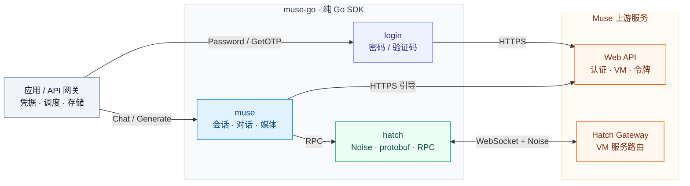

> **广告 · Muse 成品号**
>
> 需要 Muse 成品号，请联系 Telegram：[@coolkhz](https://t.me/coolkhz)。

<div align="center">

# muse-go

**将 Muse 的登录、加密通信与生成能力接入你的 Go 服务。**

纯 Go · 无需浏览器 · 密码 / 验证码登录 · Noise / Hatch · 对话与媒体

[](https://github.com/kcd-dev/muse-go/actions/workflows/ci.yml)
[](go.mod)
[](LICENSE)
[](docs/protocol.md)

[快速开始](#快速开始) · [架构设计](#架构设计) · [SDK 接入](#sdk-接入) · [协议文档](docs/protocol.md) · [接入边界](#接入边界)

</div>

---

`muse-go` 是从 muse2api 提取的独立 Go 协议库，封装了 **认证 → 会话引导 → 加密连接 → RPC → 对话与媒体输出** 的完整调用链。适合构建自托管 API 网关、为 Go 应用接入生成能力，或研究 Muse 网页端的通信协议。

上层通过 `login` 和 `muse` 完成业务接入；需要自定义请求时，可以直接使用 `hatch` 的 RPC 和流接口。

> **凭据由调用方提供。** 密码通过 `Password` 传入，验证码通过 `GetOTP` 回调提供。本库负责登录协议，不提供账号、密码获取、注册、收件箱或接码服务。

## 核心能力

| 能力 | 实现与接入价值 |
| --- | --- |
| **纯 Go 协议栈** | 直接完成 HTTPS 引导、WebSocket 握手与加密通信，无需启动 Chrome、维护页面状态或操作 DOM。 |
| **两种认证入口** | 支持密码和邮箱验证码登录；封装密码加密、CSRF 流转与会话校验，验证码来源通过回调与业务系统解耦。 |
| **Noise 加密与 RPC 复用** | 实现 `Noise_XX_25519_AESGCM_SHA256`，单条 WebSocket 按 `stream_id` 承载多个请求；支持完整响应、JSON 记录流和二进制分块。 |
| **文本与媒体统一接入** | 支持文本增量回调、参考图输入、图片 / 视频生成和分块下载，返回文件信息及可识别的宽高、时长。 |
| **连接与会话管理** | 按账号复用连接，处理 VM 唤醒和 Cookie 轮换；提供更新 hook、空闲回收及 HTTP(S) / SOCKS 代理配置。 |
| **可验证的错误处理** | 支持 context 超时与取消、断连唤醒、缓冲上限及 `NoRetry` 分类；使用公开 Noise 向量、本地模拟网关和竞态测试验证。 |

## 架构设计

三个公共包分别承担认证、业务协议和加密传输。调用方将 `login.Result` 中的 Cookie 传入 `muse.Account`，并管理账号与存储策略。



**首次接入的路径：** 登录取得会话 Cookie → 查询并唤醒 VM → 申请临时令牌 → 建立 Noise 通道 → 提交 `/chat/stream` → 读取 `/chat/history` → 返回文本增量或下载媒体。

文本增量来自会话历史的持续读取，流事件用于唤醒轮询。工作区媒体沿同一网关通道下载；上游返回的外部媒体 URL 也可作为下载来源，文件保存到 `DataDir/media`。握手细节、protobuf 字段与接口顺序见 [协议说明](docs/protocol.md)。

## 快速开始

需要 **Go 1.24+** 和可用的 Muse 账号。

### 直接运行示例

```sh
git clone https://github.com/kcd-dev/muse-go.git
cd muse-go
go build -o bin/muse-protocol ./cmd/muse-protocol

export MUSE_EMAIL='user@example.com'
export MUSE_PROXY=direct

# 请求发码后，在终端输入你自行获取的验证码。
./bin/muse-protocol --auth otp --mode chat --prompt '你好'
```

| 目标 | 命令 |
| --- | --- |
| 密码登录并对话 | `./bin/muse-protocol --auth password --mode chat --prompt '你好'` |
| 只验证登录 | `./bin/muse-protocol --auth password --mode login` |
| 生成图片 | `./bin/muse-protocol --auth otp --mode image --prompt '山间日出'` |
| 生成视频 | `./bin/muse-protocol --auth otp --mode video --prompt '一朵云缓缓飘过天空'` |
| 使用已有 Cookie | `./bin/muse-protocol --auth cookie --mode chat --prompt '你好'` |

密码方式需由你设置 `MUSE_PASSWORD`；Cookie 方式需设置包含 `hatch_sess` 的 `MUSE_COOKIE`。变量说明见 [.env.example](.env.example)，程序不会自动加载 `.env`。

示例仅在当前进程持有会话，不保存账号凭据。生成文件默认写入 `./data/media`，可通过 `--output` 调整数据目录。

### 作为 Go 模块使用

```sh
go get github.com/kcd-dev/muse-go
```

## SDK 接入

### 1. 获取登录会话

选择一种认证方式，成功后统一获得 `login.Result`，供后续协议调用使用。

**密码登录**

```go
result, err := login.Login(ctx, login.Options{
    Email:    email,
    Password: password, // 由调用方提供，保留原始内容及首尾空格
    Proxy:    "direct",
})
if err != nil {
    return err
}
```

**验证码登录**

```go
result, err := login.Login(ctx, login.Options{
    Email: email,
    GetOTP: func(ctx context.Context, sentAt time.Time) (string, error) {
        // 在你的 UI、终端或业务系统中实现 waitForUserCode。
        // sentAt 标记本次发码；等待过程应响应 ctx 取消。
        return waitForUserCode(ctx, sentAt)
    },
})
if err != nil {
    return err
}
```

`Password` 与 `GetOTP` 互斥。验证码回调只在上游确认发码后调用。密码流程使用加密密码确认；账号初始化可能触发上游发送邮件，但该流程不会读取或提交验证码，也不会自动切换登录方式。

可通过 `OnStage` 接收固定阶段名称，通过 `Timeout` 设置登录时限（默认 4 分钟）。更多选项见 [login.Options](login/login.go)。

### 2. 发送对话并接收增量

```go
client := muse.NewClient(muse.Config{DataDir: "data"})
defer client.Close()

account := &muse.Account{
    ID:            "account-1", // 每个账号使用稳定且唯一的 ID
    Cookies:       result.Cookies,
    CookieExpires: result.CookieExpires,
    Proxy:         "direct",
}

reply, err := client.Chat(ctx, account, "你好", nil, func(delta string) {
    fmt.Print(delta)
})
if err != nil {
    return err
}
// reply.Text 是完整回复，reply.Media 包含本轮下载的媒体信息。
fmt.Printf("\n附带媒体文件：%d\n", len(reply.Media))
```

上述代码展示接入步骤；包含 imports、context 与错误处理的完整程序见 [examples/basic/main.go](examples/basic/main.go)。

### 3. 生成图片或视频

```go
files, err := client.Generate(ctx, account, muse.GenRequest{
    Kind:   "image", // 改为 "video" 生成视频
    Prompt: "生成一张山间日出图片",
    N:      1,
    OnProgress: func(percent int) {
        fmt.Printf("阶段进度：%d%%\n", percent)
    },
})
if err != nil {
    return err
}
for _, file := range files {
    fmt.Printf("%s · %s · %d bytes\n", file.Filename, file.Mime, file.Bytes)
}
```

参考图通过 `[]muse.RefImage{{Data: imageBytes, Mime: "image/png"}}` 提供：对话使用 `Chat` 的 `refs` 参数，生成使用 `GenRequest.Refs`。支持最多 4 张参考图，单张不超过 10 MiB，总计不超过 24 MiB。

返回的 `Media` 包含 `Filename`、`Mime`、`Bytes`，以及可识别的 `Width`、`Height`、`Seconds`。`N` 限制最多返回的文件数；请求多张时需在 prompt 表达数量，并检查实际 `len(files)`。

## 面向服务集成

| 关注点 | 接入方式 |
| --- | --- |
| **账号与 Cookie** | `Account` 作为不可变快照传入。使用 `SetHooks` 接收 Cookie 轮换和会话变化，由调用方同步、持久化并为后续请求提供新快照。 |
| **连接生命周期** | 复用一个 client；长期运行时启动 `go client.Janitor(ctx)` 回收空闲连接，退出时调用 `Close()`。在发起并发请求前设置好 hooks。 |
| **超时与取消** | 为每次调用传入 context；登录、对话和生成有各自超时配置。验证码回调也应遵守 context。 |
| **错误与重试** | 使用 `KindOf` 分类、`RetryAfterOf` 读取退避建议；遇到 `NoRetry` 时避免重放可能已送达的生成请求。库不自动重试整个任务。 |
| **网络代理** | 支持 HTTP(S)、SOCKS5/SOCKS5H。`Account.Proxy` 优先于 `Config.Proxy`，空值继承环境代理，`direct` 表示直连；无效代理返回错误。 |
| **权限请求** | 默认只自动拒绝当前会话的待决审批。可通过 `ApprovalPolicy` 显式配置 `deny`、`off` 或 `allow`。 |
| **凭据与文件** | 库不主动保存密码、验证码或账号 Cookie；凭据字段不参与结果 JSON 序列化。生成媒体会写入本地，库新建的目录 / 文件权限为 `0700` / `0600`。 |

默认日志静默，公开错误与诊断不回显上游响应正文。调用方仍需避免记录完整账号对象、连接 URL 或底层响应内容。

## 公共 API 与目录

| 包 | 主要入口 | 适用层次 |
| --- | --- | --- |
| [`login`](login) | `Login` · `Options` · `Result` | 接入密码 / 验证码登录与会话校验 |
| [`muse`](muse) | `NewClient` · `Chat` · `Generate` · `RenewSession` · `Diagnose` | 构建应用、任务处理或 API 反代 |
| [`hatch`](hatch) | `Connect` · `Do` · `OpenContext` · `NextJSON` · `NextChunk` | 自定义底层 RPC 与流式消费 |

```text
.
├── login/                 # 原生认证与密码加密
├── muse/                  # 会话引导、对话、媒体与错误分类
├── hatch/                 # Noise、protobuf、RPC 与流复用
├── internal/
│   ├── netproxy/          # HTTP(S) / SOCKS 网络路由
│   ├── wsock/             # WebSocket 传输
│   └── fakemuse/          # 本地模拟站点与网关
├── cmd/muse-protocol/     # 可运行的命令行示例
├── examples/basic/        # 最小 SDK 接入程序
└── docs/                  # 协议说明与开源范围
```

## 测试与验证

测试使用合成账号数据和本地 HTTP / WebSocket 服务，无需真实凭据。

| 验证层 | 覆盖内容 |
| --- | --- |
| 认证 | 密码加密与解封、两种登录分支、账号身份校验、验证码回调和取消 |
| 加密与传输 | 公开 cacophony Noise 向量、RPC 流、分块组装、断连与取消唤醒 |
| 业务协议 | 模拟网关端到端对话、历史轮询、媒体完成判定、下载及元数据解析 |
| 隐私与并发 | 凭据序列化隔离、错误脱敏、连接生命周期与 race detector |

```sh
go test -race ./...
go vet ./...
go build ./...
```

[GitHub Actions](https://github.com/kcd-dev/muse-go/actions/workflows/ci.yml) 对每次 push / pull request 执行格式、静态检查、竞态测试和编译。验证范围为本地模拟服务与公开测试向量；真实上游可用性取决于账号、网络及协议版本。

## 接入边界

- **非官方协议实现。** 需要已有可用账号；上游登录状态、验证要求及接口变化可能影响可用性。遇到额外验证时会停止并返回错误。
- **作为 SDK 嵌入服务。** 仓库提供协议方法和示例；OpenAI / Anthropic HTTP 兼容层、账号池、额度管理与任务持久化由上层实现。
- **每次 Chat 使用独立会话。** 多轮上下文由调用方组织到 prompt 中；取消本地等待不代表上游生成或计费一定停止。
- **以实际媒体结果为准。** 输出张数可能少于 `N`，尺寸与时长由上游决定；下载失败不会自动重新生成。
- **支持标准 VM 流程。** 当前不支持需要 RV 密钥认证的机密 VM，也不提供硬件远程证明验证。

## 文档与贡献

- [写代码说明](docs/coding.md)：登录、会话、对话、生成、错误分类和库内改动契约。
- [协议说明](docs/protocol.md)：认证、HTTPS 引导、Noise 握手、protobuf 字段、历史轮询和媒体下载。
- [开源整理范围](docs/release-scope.md)：提取范围、凭据处理与已知限制。
- [来源与第三方许可](THIRD_PARTY_NOTICES.md)：协议参考项目、公开测试向量及依赖许可。

欢迎通过 [Issues](https://github.com/kcd-dev/muse-go/issues) 反馈协议变化，或提交带有模拟服务回归用例的 PR。报告问题时请提供 Go 版本、调用方式、错误阶段和脱敏后的复现步骤，移除密码、验证码、Cookie、令牌及代理凭据。

## 许可证与致谢

本仓库作者有权许可的原创贡献采用 [MIT License](LICENSE)。感谢 [MuseAI-API](https://github.com/minhquan130599/MuseAI-API)、[muse2api-http](https://github.com/its-benjamin/muse2api-http) 的协议研究与实现参考，以及 [Cacophony](https://github.com/haskell-cryptography/cacophony) 的公开 Noise 测试向量。

第三方内容遵循各自的许可；参考项目的许可情况和完整声明见 [THIRD_PARTY_NOTICES.md](THIRD_PARTY_NOTICES.md)。
